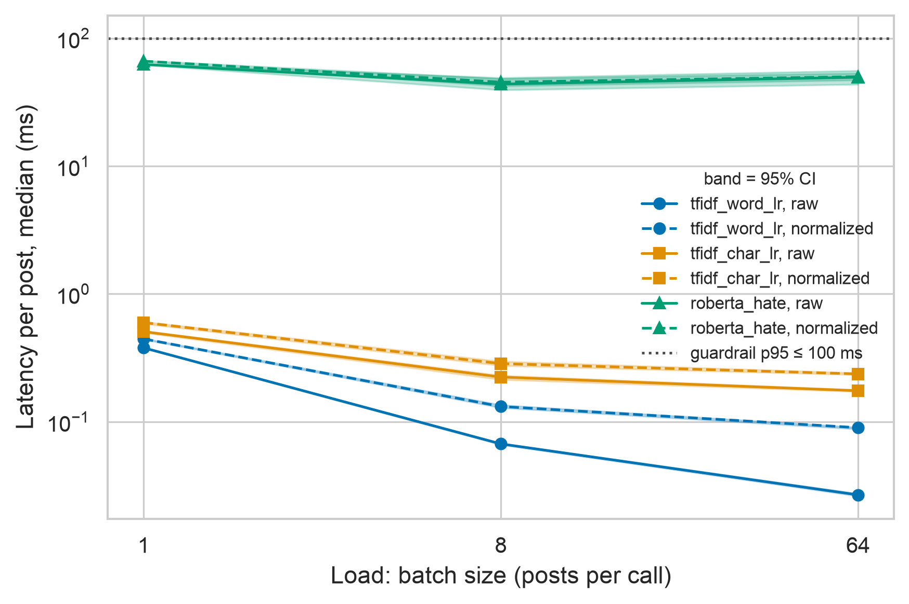
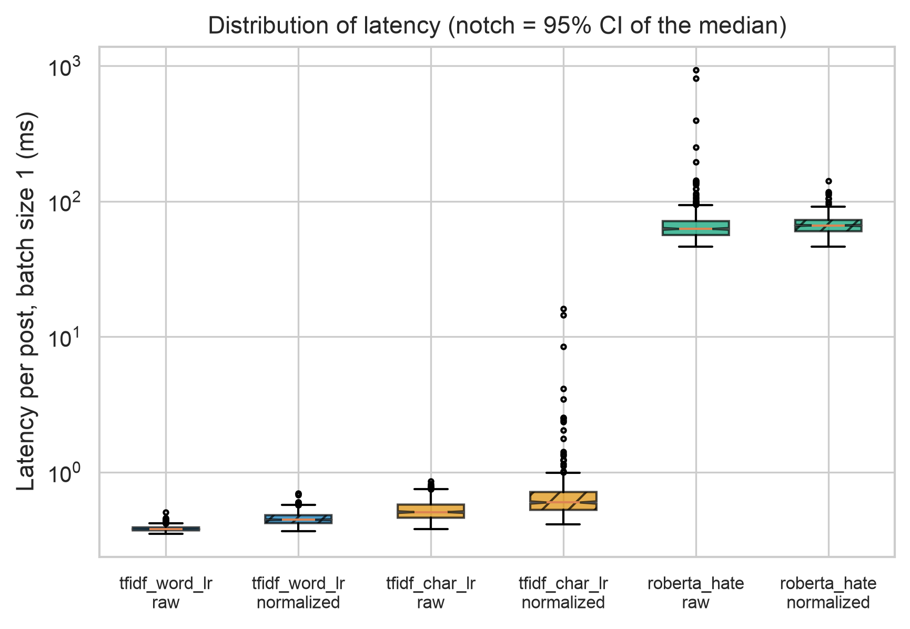
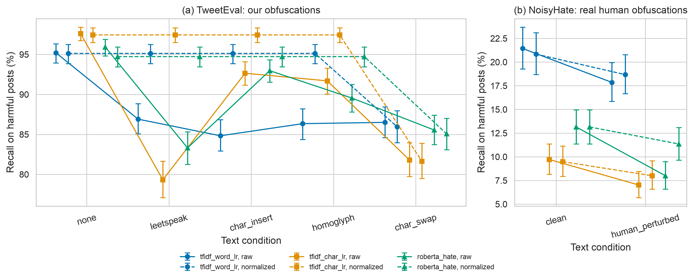

# Robustness of AI-Based Content Moderation to Character-Level Obfuscation

[](https://github.com/zeinepka07/ai-moderation-robustness-benchmark/actions/workflows/ci.yml)

**Authors:** Azaliya Sultanbek, Zeinep Egemkul (Narxoz University, 2026)
**Course project:** *The Effectiveness of AI-Based Content Moderation in Detecting Harmful Content on Social Media*: Task 2, measurement tool
**Methodology card:** [`docs/methodology_card.md`](docs/methodology_card.md) · **License:** MIT

---

## Overview

Social media users often evade automated moderation by obfuscating harmful words:
`idiot → 1d10t`, `trash → t*rash`, Latin letters swapped for look-alike Cyrillic
ones, deliberate typos. The literature reports that detectors break on rare,
noisy and out-of-distribution text (Zhang & Luo, 2019; Nejadgholi & Kiritchenko, 2020;
Ye et al., 2023), but these effects are seldom measured for different model families
under one controlled protocol.

This repository contains a **reproducible benchmark** that applies four
deterministic, human-like obfuscation strategies to a fixed hate-speech test set
and measures how much the **detection rate (recall) of harmful posts** drops for
three moderation models, together with false-positive rate, latency and memory.

## Research Question

> **RQ (refined RQ3 of Task 1):** How does character-level obfuscation of harmful
> posts (leetspeak, inserted separators, homoglyphs, typos) affect the recall
> of AI-based content moderation models, and does the effect differ between a
> word-level baseline, a character-level model and a pre-trained transformer?

| | Hypothesis |
|---|---|
| **H0** | For a given model, recall on harmful posts under obfuscation is **not lower** than on the original posts (no significant paired difference, McNemar one-sided, Holm-adjusted *p* ≥ 0.05). |
| **H1** | Obfuscation **reduces** recall on harmful posts by at least **5 percentage points** (Holm-adjusted *p* < 0.05). |

## Repository structure

```text
ai-moderation-robustness-benchmark/
├── .github/workflows/ci.yml      # CI: docker build + smoke test on every push
├── configs/
│   ├── config.yaml               # smoke test on data/sample (default)
│   └── experiment.yaml           # full Week-7 experiment on TweetEval-hate
├── data/
│   ├── README.md                 # data card (sources, schema, ethics)
│   ├── sample/                   # 8-row synthetic train/test files (versioned)
│   ├── raw/                      # downloaded datasets (git-ignored)
│   └── processed/                # Task 3: metrics_summary.csv, latency_summary.csv, hypothesis_tests.csv
├── docs/
│   ├── methodology_card.md       # Methodology Passport Card
│   ├── domain_model.md           # Task 3: loss, operators, metrics, notation (LaTeX)
│   └── references.bib            # bibliography (Zotero export)
├── notebooks/
│   └── 01_data_analysis.ipynb    # Task 3: executed analysis notebook (seed 42)
├── reports/figures/              # Task 3: fig1–fig3 as .pdf (vector) and .png (300 dpi)
├── scripts/
│   ├── download_data.py          # reproducible download of TweetEval-hate
│   └── collect_raw_log.py        # Task 3: runs the experiment -> data/raw/test_run.jsonl
├── src/
│   ├── benchmark.py              # experiment runner (entry point)
│   ├── models.py                 # detectors: TF-IDF + LogReg, HF transformer
│   ├── perturbations.py          # obfuscation strategies (independent variable)
│   ├── normalize.py              # Task 3: proposed method, text normalisation
│   ├── process_data.py           # Task 3: warm-up filtering, statistics, hypothesis tests
│   ├── visualize.py              # Task 3: publication-ready figures
│   └── metrics.py                # metrics, McNemar test, bootstrap CI, Holm
├── tests/                        # unit + smoke tests (test_task3.py: normalisation, warm-up, tests)
├── results/                      # run outputs (git-ignored)
├── Dockerfile
├── requirements.txt              # core deps, exact pins
├── requirements-transformer.txt  # optional transformer deps, exact pins
├── requirements-analysis.txt     # Task 3: matplotlib, seaborn, jupyter
├── CITATION.cff
└── LICENSE
```

## Planned benchmarks (Week 7)

Full factorial design: **3 models × 5 text conditions = 15 runs**, each on the same
2,970 test tweets (TweetEval-hate test split), seed 42.

| Model (IV 1) | Type | Training | Role |
|---|---|---|---|
| `tfidf_word_lr` | TF-IDF word 1–2-grams + logistic regression | 9,000 clean train tweets | **Baseline** |
| `tfidf_char_lr` | TF-IDF char 2–5-grams + logistic regression | 9,000 clean train tweets | Classical ML, sub-word features |
| `roberta_hate` | [`cardiffnlp/twitter-roberta-base-hate-latest`](https://huggingface.co/cardiffnlp/twitter-roberta-base-hate-latest) | pre-trained, used as-is | Off-the-shelf AI moderator |

| Text condition (IV 2) | Example (`stupid idiot`) |
|---|---|
| `none` (control) | stupid idiot |
| `leetspeak` | 57up1d 1d107 |
| `char_insert` | st-upid id.iot |
| `homoglyph` | stupіd іdіot *(Cyrillic і)* |
| `char_swap` | sutpid idoit |

`word_rate = 0.5`: half of all eligible words (≥ 4 letters, not `@mentions`/URLs) are obfuscated.

| Measured per run | Unit |
|---|---|
| **Recall on harmful class (primary)** and Δ recall vs. `none` | %, percentage points |
| Precision, F1, macro-F1, ROC-AUC | 0–1 |
| False-positive rate on benign posts *(guardrail ≤ 0.20)* | 0–1 |
| Latency per text: mean, p50, p95 *(guardrail p95 ≤ 100 ms)* | ms |
| Throughput | texts/s |
| Peak resident memory *(guardrail ≤ 4096 MB)* | MB |
| Failed or timed-out inferences *(guardrail = 0)* | count |

## Results & Discussion (Task 3)

**What was added in Task 3.** The registered experiment of Task 2 (H1) is unchanged. On top of it we test a
simple defence, **text normalisation** ([`src/normalize.py`](src/normalize.py), 30 lines): Unicode NFKC + lower case,
look-alike Cyrillic/Greek letters → Latin, separators inside words removed, digits/symbols used as letters → letters,
letters repeated 3+ times → once. This gives a second, exploratory hypothesis:

> **H2:** on obfuscated posts, the normalised pipeline catches more harmful posts than the raw pipeline.

Because our own obfuscations are partly the inverse of these rules, we also test on **NoisyHate** (Ye et al., 2023):
1,339 toxic comments, each with a version disguised by real people (`trashhhh`, `cl0wn`, `StUpiD`, `ridiclous`).

**Setup.** TweetEval-hate (train 9,000 / validation 1,000 / test 2,970), threshold 0.5, seed 42. Final run on an
Apple M-series laptop (macOS 14, 8 CPU cores, 8 GB RAM, CPU only). Full calculation:
[`notebooks/01_data_analysis.ipynb`](notebooks/01_data_analysis.ipynb); raw log: [`data/raw/test_run.jsonl`](data/raw/test_run.jsonl).
Warm-up calls are dropped; 95% CIs are percentile bootstrap (2,000 resamples); tests are one-sided exact McNemar,
Holm-corrected inside each hypothesis family.

**Table 1. Recall on harmful posts, % [95% CI] — Baseline vs Proposed**

| Model | Pipeline | Clean | Leetspeak | Char. insert | Homoglyph | Char. swap | NoisyHate clean | NoisyHate human-perturbed |
|---|---|---|---|---|---|---|---|---|
| `tfidf_word_lr` | Baseline (raw) | 95.2 [93.9, 96.3] | 86.9 [85.1, 88.8] | 84.8 [82.9, 86.8] | 86.3 [84.4, 88.2] | 86.5 [84.6, 88.4] | 21.4 [19.3, 23.7] | 17.8 [15.8, 19.9] |
| `tfidf_word_lr` | **Proposed** (normalized) | 95.1 [93.8, 96.2] | 95.1 [93.8, 96.2] | 95.1 [93.8, 96.2] | 95.1 [93.8, 96.2] | 85.9 [84.0, 87.9] | 20.8 [18.7, 23.1] | 18.7 [16.7, 20.8] |
| `tfidf_char_lr` | Baseline (raw) | 97.6 [96.7, 98.4] | 79.3 [77.1, 81.6] | 92.7 [91.1, 94.1] | 91.7 [90.0, 93.3] | 81.8 [79.7, 84.0] | 9.7 [8.1, 11.3] | 7.0 [5.7, 8.4] |
| `tfidf_char_lr` | **Proposed** (normalized) | 97.4 [96.5, 98.3] | 97.4 [96.5, 98.3] | 97.4 [96.5, 98.3] | 97.4 [96.5, 98.3] | 81.6 [79.5, 83.9] | 9.5 [7.9, 11.1] | 8.0 [6.6, 9.6] |
| `roberta_hate` | Baseline (raw) | 95.9 [94.8, 96.9] | 83.3 [81.2, 85.3] | 93.0 [91.5, 94.3] | 89.5 [87.8, 91.2] | 85.5 [83.7, 87.4] | 13.1 [11.3, 14.9] | 8.0 [6.6, 9.5] |
| `roberta_hate` | **Proposed** (normalized) | 94.7 [93.5, 95.9] | 94.7 [93.5, 95.9] | 94.7 [93.5, 95.9] | 94.7 [93.5, 95.9] | 85.1 [83.1, 87.0] | 13.1 [11.3, 14.9] | 11.3 [9.6, 13.1] |

**Table 2. False-positive rate on benign posts** (guardrail: ≤ 0.20 on clean TweetEval test)

| Model | Pipeline | Validation (clean) | Test clean | Test leetspeak | Test char. insert | Test homoglyph | Test char. swap |
|---|---|---|---|---|---|---|---|
| `tfidf_word_lr` | raw | 0.323 | 0.891 | 0.765 | 0.743 | 0.776 | 0.752 |
| `tfidf_word_lr` | normalized | 0.316 | 0.887 | 0.887 | 0.887 | 0.887 | 0.746 |
| `tfidf_char_lr` | raw | 0.291 | 0.923 | 0.710 | 0.836 | 0.835 | 0.733 |
| `tfidf_char_lr` | normalized | 0.300 | 0.920 | 0.920 | 0.920 | 0.920 | 0.721 |
| `roberta_hate` | raw | 0.133 | 0.201 | 0.276 | 0.388 | 0.307 | 0.287 |
| `roberta_hate` | normalized | 0.166 | 0.233 | 0.233 | 0.233 | 0.233 | 0.317 |

**Table 3. Hypothesis tests** (paired; Δ = first − second; supported = Holm p < 0.05 and Δ ≥ 5 pp)

| Family | Model | Comparison | Δ recall, pp [95% CI] | Holm p | Supported |
|---|---|---|---|---|---|
| H1 | `tfidf_word_lr` | tweeteval: clean vs leetspeak | 8.3 [6.5, 9.9] | < 0.001 | yes |
| H2 | `tfidf_word_lr` | tweeteval leetspeak: normalized vs raw | 8.2 [6.5, 9.9] | < 0.001 | yes |
| H1 | `tfidf_word_lr` | tweeteval: clean vs char_insert | 10.4 [8.4, 12.3] | < 0.001 | yes |
| H2 | `tfidf_word_lr` | tweeteval char_insert: normalized vs raw | 10.3 [8.3, 12.2] | < 0.001 | yes |
| H1 | `tfidf_word_lr` | tweeteval: clean vs homoglyph | 8.9 [7.1, 10.8] | < 0.001 | yes |
| H2 | `tfidf_word_lr` | tweeteval homoglyph: normalized vs raw | 8.8 [6.9, 10.7] | < 0.001 | yes |
| H1 | `tfidf_word_lr` | tweeteval: clean vs char_swap | 8.7 [6.9, 10.5] | < 0.001 | yes |
| H2 | `tfidf_word_lr` | tweeteval char_swap: normalized vs raw | -0.6 [-1.4, 0.2] | 1.000 | no |
| H1 | `tfidf_word_lr` | noisyhate: clean vs human_perturbed | 3.6 [2.2, 5.0] | < 0.001 | no |
| H2 | `tfidf_word_lr` | noisyhate human_perturbed: normalized vs raw | 0.8 [-0.3, 1.9] | 0.443 | no |
| H1 | `tfidf_char_lr` | tweeteval: clean vs leetspeak | 18.3 [16.1, 20.4] | < 0.001 | yes |
| H2 | `tfidf_char_lr` | tweeteval leetspeak: normalized vs raw | 18.1 [16.0, 20.3] | < 0.001 | yes |
| H1 | `tfidf_char_lr` | tweeteval: clean vs char_insert | 5.0 [3.8, 6.2] | < 0.001 | no |
| H2 | `tfidf_char_lr` | tweeteval char_insert: normalized vs raw | 4.8 [3.6, 6.1] | < 0.001 | no |
| H1 | `tfidf_char_lr` | tweeteval: clean vs homoglyph | 5.9 [4.5, 7.3] | < 0.001 | yes |
| H2 | `tfidf_char_lr` | tweeteval homoglyph: normalized vs raw | 5.8 [4.3, 7.2] | < 0.001 | yes |
| H1 | `tfidf_char_lr` | tweeteval: clean vs char_swap | 15.8 [13.8, 17.8] | < 0.001 | yes |
| H2 | `tfidf_char_lr` | tweeteval char_swap: normalized vs raw | -0.2 [-0.8, 0.5] | 1.000 | no |
| H1 | `tfidf_char_lr` | noisyhate: clean vs human_perturbed | 2.7 [1.8, 3.7] | < 0.001 | no |
| H2 | `tfidf_char_lr` | noisyhate human_perturbed: normalized vs raw | 1.0 [0.2, 1.8] | 0.072 | no |
| H1 | `roberta_hate` | tweeteval: clean vs leetspeak | 12.6 [10.6, 14.5] | < 0.001 | yes |
| H2 | `roberta_hate` | tweeteval leetspeak: normalized vs raw | 11.4 [9.3, 13.6] | < 0.001 | yes |
| H1 | `roberta_hate` | tweeteval: clean vs char_insert | 3.0 [1.7, 4.2] | < 0.001 | no |
| H2 | `roberta_hate` | tweeteval char_insert: normalized vs raw | 1.8 [0.2, 3.4] | 0.083 | no |
| H1 | `roberta_hate` | tweeteval: clean vs homoglyph | 6.4 [4.8, 8.0] | < 0.001 | yes |
| H2 | `roberta_hate` | tweeteval homoglyph: normalized vs raw | 5.2 [3.4, 6.9] | < 0.001 | yes |
| H1 | `roberta_hate` | tweeteval: clean vs char_swap | 10.4 [8.5, 12.2] | < 0.001 | yes |
| H2 | `roberta_hate` | tweeteval char_swap: normalized vs raw | -0.5 [-1.9, 0.8] | 1.000 | no |
| H1 | `roberta_hate` | noisyhate: clean vs human_perturbed | 5.2 [3.1, 6.9] | < 0.001 | yes |
| H2 | `roberta_hate` | noisyhate human_perturbed: normalized vs raw | 3.4 [1.6, 4.9] | < 0.001 | no |

**Table 4. Speed on CPU** (clean text; 95% CI in brackets; guardrail p95 ≤ 100 ms at batch size 1)

| Model | Pipeline | Latency, bs = 1: median (p25–p75), ms | p95, ms | p99, ms | Mean ± SD, ms | Throughput bs = 1, posts/s | Throughput bs = 8, posts/s | Throughput bs = 64, posts/s |
|---|---|---|---|---|---|---|---|---|
| `tfidf_word_lr` | raw | 0.38 (0.37–0.39) | 0.41 | 0.43 | 0.38 ± 0.02 | 2615 | 14976 | 37396 |
| `tfidf_word_lr` | normalized | 0.45 (0.42–0.48) | 0.55 | 0.59 | 0.46 ± 0.05 | 2197 | 7590 | 11212 |
| `tfidf_char_lr` | raw | 0.51 (0.46–0.58) | 0.73 | 0.77 | 0.53 ± 0.10 | 1872 | 4579 | 5721 |
| `tfidf_char_lr` | normalized | 0.60 (0.53–0.71) | 0.92 | 2.46 | 0.71 ± 0.92 | 1471 | 3569 | 4228 |
| `roberta_hate` | raw | 62.54 (56.34–71.38) | 91.43 | 140.31 | 69.05 ± 49.69 | 15 [13, 16] | 23 [22, 24] | 20 [18, 21] |
| `roberta_hate` | normalized | 66.33 (60.12–72.74) | 81.10 | 97.31 | 67.13 ± 9.76 | 15 [15, 15] | 23 [22, 23] | 20 [20, 20] |

Peak RAM: about 0.2–0.26 GB for TF-IDF, about 1.0 GB for RoBERTa. Failed posts: 0 for all pipelines.

### Figures



*Figure 1.* Median latency per post vs. load (batch size), with 95% CI bands. Dotted line: 100 ms guardrail.



*Figure 2.* Distribution of latency per post at batch size 1. Notch = 95% CI of the median; hatched = normalised pipeline.



*Figure 3.* Recall with 95% CI: (a) TweetEval with our obfuscations, (b) NoisyHate with real human obfuscations.
Solid = raw pipeline, dashed = normalised. Vector `.pdf` versions are in [`reports/figures/`](reports/figures/).

### Domain model

Loss function, obfuscation and normalisation operators, metrics, decision rule and notation:
[`docs/domain_model.md`](docs/domain_model.md).

### Discussion

1. **H1 is supported for most pairs.** Obfuscation lowered recall significantly in all 12 TweetEval pairs; the drop was
   ≥ 5 pp in 10 of 12 (word model 8.3–10.4 pp, character model 5.0–18.3 pp, RoBERTa 3.0–12.6 pp). Inserted separators hurt
   the character model and RoBERTa least (< 5 pp). On real human obfuscations (NoisyHate) the drop is 2.7–3.6 pp for TF-IDF
   and 5.2 pp for RoBERTa. Unexpectedly, the character n-gram model was *less* robust than the word baseline to leetspeak
   and character swaps.
2. **Model families differ mainly in false positives.** Both TF-IDF models flag most benign test posts (FPR ≈ 0.89–0.92 on
   test vs ≈ 0.3 on validation): they are trained on the HatEval train split, whose test split is known to be shifted. Their
   high recall on TweetEval is therefore inflated. RoBERTa, pre-trained on other data, keeps FPR at ≈ 0.20 — exactly at the
   guardrail — and is the only model whose recall is meaningful. Obfuscation raises RoBERTa's FPR to 0.28–0.39: disguised
   benign posts look suspicious to it.
3. **Normalisation (H2) fixes the tricks it knows, and part of real ones.** On TweetEval it restores recall to the clean
   level for leetspeak, inserted separators and homoglyphs for all three models, but not for character swaps (typos), which
   no rule can reverse. Since the rules partly mirror our own obfuscations, this is expected. On NoisyHate, normalisation gives
   back **3.4 of 5.2 pp (≈ 65 %) for RoBERTa** (Holm p < 0.001), but only 0.8 of 3.6 pp for the word model and 1.0 of 2.7 pp for
   the character model, which are not significant. None reaches the 5 pp threshold, because the whole loss is ≈ 5 pp or less.
4. **Normalisation has a price for RoBERTa.** On clean text it lowers RoBERTa's recall from 95.9 % to 94.7 % and raises FPR from
   0.201 to 0.233, probably because lower-casing removes information the case-sensitive transformer uses. For TF-IDF the cost
   is negligible.
5. **Speed.** TF-IDF needs < 1 ms per post. RoBERTa needs a median of 63 ms and p95 of 91 ms per post at batch size 1, so it
   just passes the 100 ms guardrail (p99 = 140 ms). Its best throughput is at batch size 8 (≈ 23 posts/s); batch size 64 is
   slightly slower, likely because short tweets are padded to the longest one in the batch. RAM stays ≤ about 1 GB.
6. **Limitations.** Synthetic obfuscations partly mirror the normalisation rules; NoisyHate contains toxic comments rather than
   hate speech, so absolute recall there is low and only paired differences are interpreted; English only; CPU only. Small
   effects (≈ 1 pp) varied slightly between a first run on an x86 server and this final run, so only effects with clear CIs are
   interpreted.

**Practical recommendation.** Of the tested models only the pre-trained transformer is usable as a moderator (FPR ≈ 0.20).
Adding a 30-line normalisation step in front of it recovers about two thirds of the recall lost to real human obfuscation, at
the cost of about 1 pp clean recall and 3 pp more false positives. A platform should decide whether that trade-off is worth it;
normalisation cannot fix typo-style changes, for which a model trained on noisy text is needed.

## Reproduce Task 3

```bash
pip install -r requirements.txt -r requirements-analysis.txt -r requirements-transformer.txt
python scripts/download_data.py                                     # TweetEval-hate -> data/raw/tweeteval_hate/
#   if raw.githubusercontent.com is blocked: git clone https://github.com/cardiffnlp/tweeteval /tmp/tweeteval
#   and run: python scripts/download_data.py --local /tmp/tweeteval/datasets/hate
git clone https://github.com/YiranYe/NoisyHate data/raw/NoisyHate     # real human obfuscations
python scripts/collect_raw_log.py --config configs/task3.yaml       # -> data/raw/test_run.jsonl (~35 min with RoBERTa on a laptop CPU)
python -m src.process_data                                          # -> data/processed/*.csv
python -m src.visualize                                             # -> reports/figures/*.pdf, *.png
jupyter nbconvert --to notebook --execute --inplace notebooks/01_data_analysis.ipynb
```

## System requirements

- **Docker** ≥ 24 (recommended), or **Python 3.13** with `pip`
- CPU only, no GPU needed. ≥ 4 GB RAM (8 GB for `roberta_hate`)
- Disk: ~0.5 GB (core image), ~2.5 GB (image with transformer + model cache)
- Internet only for the full experiment (dataset + model download)

## Quickstart Guide (smoke test, ~1 minute)

```bash
git clone https://github.com/azaliyasultanbek-create/ai-moderation-robustness-benchmark.git && cd ai-moderation-robustness-benchmark
docker build -t ai-mod-bench .
docker run --rm -v "${PWD}/results:/app/results" ai-mod-bench
```

The run prints a summary table and writes `results/smoke_test_<timestamp>/`.
On Windows `cmd.exe` replace `${PWD}` with `%cd%` (PowerShell works as is).

**Without Docker:**

```bash
python -m venv .venv && source .venv/bin/activate      # Windows: .venv\Scripts\activate
pip install -r requirements.txt
python -m src.benchmark --config configs/config.yaml
```

Run the tests: `python -m unittest discover -s tests -v`

## Full experiment (Week 7)

```bash
docker build -t ai-mod-bench:full --build-arg WITH_TRANSFORMER=1 .
docker run --rm -v "${PWD}/data:/app/data" --entrypoint python ai-mod-bench:full scripts/download_data.py
docker run --rm -v "${PWD}/data:/app/data" -v "${PWD}/results:/app/results" \
           -v hf-cache:/cache/huggingface ai-mod-bench:full --config configs/experiment.yaml
```

Without Docker: `pip install -r requirements-transformer.txt`, `python scripts/download_data.py`,
`python -m src.benchmark --config configs/experiment.yaml`. Expected time on a 4-core
laptop CPU is 10–20 minutes. The transformer accounts for most of it.

## Outputs

Every run creates `results/<experiment>_<YYYYmmdd-HHMMSS>/`:

| File | Content |
|---|---|
| `benchmark.log` | full console log of the run |
| `metrics.csv` | one row per model × condition: all dependent variables + guardrail flags |
| `hypothesis_tests.csv` | recall clean vs. perturbed, Δ pp, bootstrap 95% CI, McNemar *p*, Holm *p*, `h0_rejected` |
| `predictions.csv` | item-level scores and predictions (for error analysis) |
| `run_metadata.json` | config snapshot, SHA-256 of data files, Python/OS/CPU/RAM, package versions, git commit |

## Configuration

All experimental parameters live in `configs/*.yaml`: data paths, models and their
hyper-parameters (IV 1), perturbation types, `word_rate` and `apply_to` (IV 2),
decision threshold, batch size, warm-up batches, timeout per condition, bootstrap
iterations, α, minimal effect size, guardrail thresholds and CPU threads.

## Reproducibility

- Exact version pins for every dependency (including transitive ones); `pip check` runs during `docker build`.
- GitHub Actions rebuilds the Docker image and runs the smoke test and unit tests on every push (badge at the top).
- Fixed seed (42) for perturbations, model initialisation and bootstrap; perturbations are seeded per item, so every model sees identical inputs.
- Models are trained on **clean** text only; obfuscation is applied at test time (adversarial setting).
- Latency excludes warm-up batches; the transformer's Hub commit hash is logged.

## Citation

```bibtex
@software{sultanbek_egemkul_2026_moderation_bench,
  author  = {Sultanbek, Azaliya and Egemkul, Zeinep},
  title   = {Robustness of AI-Based Content Moderation to Character-Level Obfuscation of Harmful Content},
  year    = {2026},
  url     = {https://github.com/zeinepka07/ai-moderation-robustness-benchmark},
  version = {0.1.0}
}
```

Dataset: Basile et al. (2019), SemEval-2019 Task 5; Barbieri et al. (2020), TweetEval.
Full bibliography: [`docs/references.bib`](docs/references.bib).

## License

Code is released under the [MIT License](LICENSE). The TweetEval data and the
pre-trained model keep their original licenses and are not redistributed here.

## Contributions

| Author | Contribution |
|---|---|
| Zeinep Egemkul | Research design, hypotheses (H0/H1), variable matrix and metrics, methodology card |
| Azaliya Sultanbek | Literature review, repository setup, Docker environment, README |
